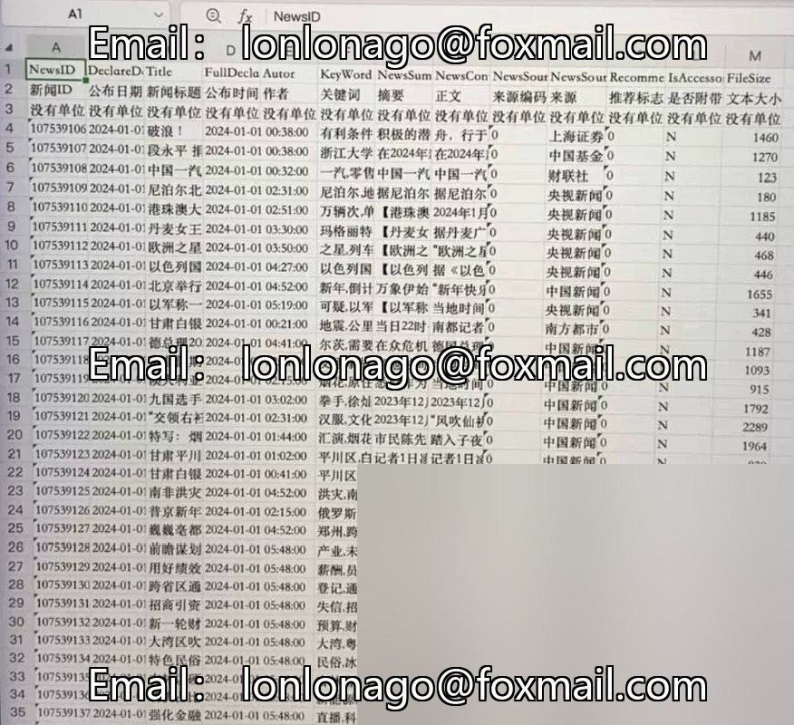
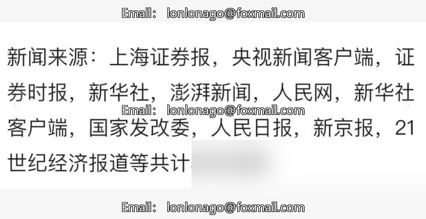

# News text data of over 8 million entries

## Body

News text data of over 8 million items
Time: 2000-2024
There are also news for various securities companies
Fields: News ID, publication date, news title, news text, source, etc.
News source: Look at four

web-based shipment, can be directly photographed and shipped.

The news text data total is more than 8 million entries, covering fields such as news ID, publish date, news title, news text and source, with an Excel format and multiple news sources available.

<!-- AI_ENRICHED -->

## Images

## Payment

Here is a pay link on Stripe ( https://buy.stripe.com/3cs8yP7sY87d0vu9AB ). Please contact me lonlonago@foxmail.com after funding $89, and I will send you a complete data files , thank you!

